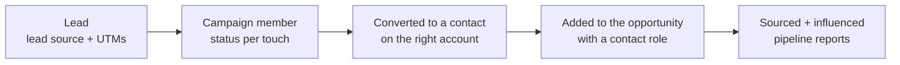

# B2B Pipeline Attribution Tool

> **B2B Campaign Lifecycle Toolkit**, step 7 of 7
>
> [1. Position](https://github.com/rachelhong-marketing/b2b-product-marketing-agent) → [2. Plan](https://github.com/rachelhong-marketing/b2b-campaign-assistant) → [3. Content](https://github.com/rachelhong-marketing/b2b-content-strategy-assistant) → [4. Set up](https://github.com/rachelhong-marketing/b2b-paid-media-planner) → [5. Test](https://github.com/rachelhong-marketing/b2b-campaign-test-planner) → [6. Report](https://github.com/rachelhong-marketing/b2b-campaign-reporting-agent) → **7. Prove**

A practical guide to measuring marketing's contribution to pipeline in a B2B CRM, mainly Salesforce, with notes for HubSpot.

Most B2B teams have the tools to show which campaigns created and moved pipeline. What breaks is the chain of records in between: a lead that never gets converted, a contact with no role on the deal, a UTM that never reaches the CRM. This playbook walks through that chain step by step. It also includes an **attribution auditor**: export 7 standard Salesforce reports, and it tells you whether the data can be trusted before it gives you sourced and influenced pipeline. Everything runs on made-up sample data out of the box.

## The chain



If any link is missing, the campaign's credit stops there.

## Run the audit

### With Claude Code (no commands to type)

The repo includes a Claude Code skill, `.claude/skills/pipeline-attribution-auditor/SKILL.md`. Download the repo, open the folder in Claude Code, and ask:

- "Show me how the attribution audit works on the sample data."
- "Which Salesforce reports do I need to export?"
- "Audit my exports in exports/2026-11. Our sales cycle is about 9 months."
- "Can we trust our Campaign Influence numbers?"

The skill walks you through the exports, checks the files, runs the audit and writes a short summary for marketing leaders with the top 3 fixes. The numbers always come from the Python code, not the AI.

### From the command line

Python 3 only, nothing to install.

```bash
python3 -m auditor guide                     # which Salesforce reports to export
python3 -m auditor check-files data          # check the files first
python3 -m auditor audit data --window 180   # run the audit (data/ is the made-up sample)
python3 -m unittest discover -s tests        # run the tests
```

To use your own data, follow [docs/export-salesforce-reports.md](docs/export-salesforce-reports.md) and point the commands at your folder. Column labels, US dates, dollar amounts and 18-character IDs from a standard Salesforce export are handled for you.

### What the audit gives you

On the sample data:

| # | Check | Status | Records | Pipeline affected |
|---|---|---|---|---|
| 1 | Deals with no contact roles | FIX | 2 | $100,000 |
| 2 | Unconverted leads at companies with open deals | FIX | 3 | $210,000 |
| 3 | Engaged contacts missing from their account's open deal | FIX | 1 | $80,000 |
| 4 | Leads with no lead source | FIX | 2 | - |
| 5 | Possible duplicate leads (same email) | FIX | 1 | - |
| 6 | Paid search leads with no GCLID | FIX | 1 | - |
| 7 | Touches outside the influence window | INFO | 1 | - |
| 8 | Influence inflated by members who never engaged | FIX | 2 | $250,000 |

Then: headline numbers (83.3% of pipeline marketing sourced, 4 of 6 deals influenced), sourced and influenced pipeline by campaign, the same deals under first-touch, last-touch and even-split attribution, and a fix list naming every record to correct. Check 8 is the one most teams miss: counting email members who were only "Sent" makes the nurture look like it influenced $320,000 of pipeline instead of $150,000.

The exports hold names and emails. The Python auditor runs only on your computer. If you use the Claude Code skill, check your company's policy on CRM data and AI tools first.

## What's inside

| # | Part | The question it answers |
|---|---|---|
| 1 | [Define the funnel](docs/01-define-the-funnel.md) | What counts as a lead, MQL, SAL, SQL and opportunity here? |
| 2 | [Capture the source](docs/02-capture-the-source.md) | Where did this person come from, and what did they engage with? |
| 3 | [Convert the lead and match the account](docs/03-convert-and-match.md) | Is this person tied to the right company record? |
| 4 | [Attach contacts with contact roles](docs/04-contact-roles.md) | Which buyers are on this deal? |
| 5 | [Sourced vs. influenced pipeline](docs/05-sourced-vs-influenced.md) | Did marketing start the deal, help it along, or both? |
| 6 | [Attribution models and tools](docs/06-attribution-models-and-tools.md) | How should credit be split across campaigns? |
| 7 | [Reconcile and audit the data](docs/07-reconcile-and-audit.md) | Why don't the numbers match across systems? |
| 8 | [Close the loop with ad platforms](docs/08-close-the-loop.md) | How do ad platforms learn which clicks became real pipeline? |

**Try it yourself**
- [`data/`](data/): a small, **fully made-up** dataset (accounts, leads, contacts, campaigns, campaign members, opportunities and contact roles), with common data problems built in on purpose. No real companies, people or results. See [data/README.md](data/README.md).
- [`auditor/`](auditor/): the Python attribution auditor (see "Run the audit" above), with tests in [`tests/`](tests/).
- [`sql/`](sql/): the same logic as plain SQL, if you'd rather run it in SQLite or adapt it to your data warehouse. See [sql/README.md](sql/README.md).
- [`templates/`](templates/): funnel definitions, a lead scoring sheet, a monthly audit checklist, a discrepancy log and spreadsheet formulas.

## Lessons from the field

These come from more than ten years of B2B demand generation at marketing and advertising technology companies. Company names and numbers are left out.

**1. The report wasn't broken. The contact roles were missing.**
A team wanted multi-touch attribution, but the Campaign Influence report came back almost empty. Sales rarely added contact roles to opportunities, so campaign activity never linked to deals. Sales Ops backfilled roles for past deals with an automation, and the influence report worked from then on. The longer-term fix was a rule that a deal can't move to a later stage without contact roles.

**2. An influence report can make one email look like it touched every deal.**
Email campaigns often add everyone on the send list as a campaign member with a status like "Sent" or "Received." If those statuses count, the influence report credits the email on every deal those people are part of, whether or not anyone opened it. Before presenting influenced pipeline, filter to people who actually clicked, attended or downloaded, so the number holds up when sales asks about it. See [Part 7](docs/07-reconcile-and-audit.md).

## The B2B Campaign Lifecycle Toolkit

Seven tools, one per step of a B2B campaign, from positioning to proving pipeline. Each works on its own; together they cover the whole cycle. All sample data is made up.

| Step | Tool | What it does |
|---|---|---|
| 1. Position | [B2B Product Marketing Agent](https://github.com/rachelhong-marketing/b2b-product-marketing-agent) | Define who you sell to and what you say: ideal customer profile, positioning, messaging pillars and proof points, checked for gaps before any campaign starts. |
| 2. Plan | [B2B Campaign Assistant](https://github.com/rachelhong-marketing/b2b-campaign-assistant) | Turn the positioning into a campaign theme, write the campaign plan and master brief, then draft channel briefs, keywords, landing page and ad copy, all checked before launch. |
| 3. Content | [B2B Content Strategy Assistant](https://github.com/rachelhong-marketing/b2b-content-strategy-assistant) | Pick content topics inside the campaign theme from audience questions, news, competitors and keyword data, outline and check each piece so search and AI answer tools can quote it, and log whether AI answers cite you. |
| 4. Set up | [B2B Paid Media Planner](https://github.com/rachelhong-marketing/b2b-paid-media-planner) | Plan channels and retargeting, then build and check tracking links before launch. |
| 5. Test | [B2B Campaign Test Planner](https://github.com/rachelhong-marketing/b2b-campaign-test-planner) | Plan tests in waves, let the ad platform call the winner, check MQLs, and size tests when volume is small. |
| 6. Report | [B2B Campaign Reporting Agent](https://github.com/rachelhong-marketing/b2b-campaign-reporting-agent) | Consolidate ad platform and CRM data into one file, check every channel and funnel stage for gaps, and draft insights. |
| 7. Prove | **B2B Pipeline Attribution Tool** (this repo) | Check the CRM data can be trusted, then show sourced and influenced pipeline. |

### Which tool is for your role

Teams are organized by function, and the steps cut across them. Start here:

| If you are a... | Start with |
|---|---|
| Product marketer | [1. Product Marketing Agent](https://github.com/rachelhong-marketing/b2b-product-marketing-agent) |
| Demand gen or campaign manager | [2. Campaign Assistant](https://github.com/rachelhong-marketing/b2b-campaign-assistant), [4. Paid Media Planner](https://github.com/rachelhong-marketing/b2b-paid-media-planner), [5. Campaign Test Planner](https://github.com/rachelhong-marketing/b2b-campaign-test-planner) |
| Content marketer | [3. Content Strategy Assistant](https://github.com/rachelhong-marketing/b2b-content-strategy-assistant) |
| Paid media manager | [4. Paid Media Planner](https://github.com/rachelhong-marketing/b2b-paid-media-planner), [5. Campaign Test Planner](https://github.com/rachelhong-marketing/b2b-campaign-test-planner) |
| Marketing operations or analytics | [5. Campaign Test Planner](https://github.com/rachelhong-marketing/b2b-campaign-test-planner), [6. Campaign Reporting Agent](https://github.com/rachelhong-marketing/b2b-campaign-reporting-agent), [7. Pipeline Attribution Tool](https://github.com/rachelhong-marketing/b2b-pipeline-attribution-tool) |

## Who this is for

Demand generation, marketing operations and revenue operations people who need to answer "what did marketing contribute to pipeline?" with data the sales team will trust.

## A note on accuracy

Salesforce and HubSpot change their features and names often. For example, Pardot is now called Marketing Cloud Account Engagement, and HubSpot has replaced some of its attribution models. Check your own org's settings and the vendors' current help docs before you build anything. Links to the docs used are at the end of each part.

## About the author

**Rachel Hong** has worked in B2B demand generation and marketing analytics for more than ten years, at marketing and advertising technology companies. She builds campaigns, reporting and the CRM processes that connect marketing to pipeline.

[LinkedIn](https://www.linkedin.com/in/rachelhongatbaruch/)
